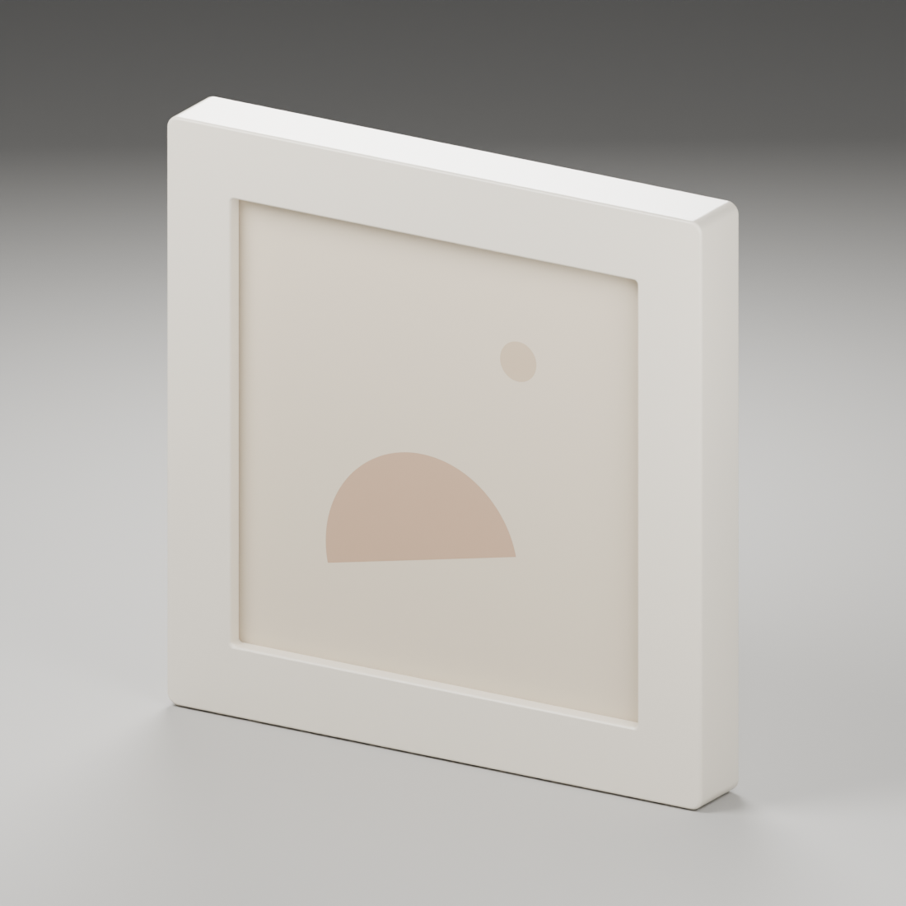

# 3D Print Workshop

个人 3D 打印模型工作坊，收录 Blender 模型源文件、设计参考、效果图与模型检查记录。

## 模型

### Picture Frame · 单钉悬挂相框



设计尺寸为 **100 × 100 × 12 mm**，正面开口 **76 × 76 mm**。包含圆角相框、独立画芯、背板、压片，以及背面居中的单钉钥匙孔挂槽。

- [Blender 模型](picture-frame/picture-frame.blend)
- [设计参考图](picture-frame/images/picture-frame-reference.png)
- [背面效果图](picture-frame/images/picture-frame-back.png)
- [挂槽细节](picture-frame/images/picture-frame-keyhole.png)
- [模型检查记录](picture-frame/model-checks.json)

当前为设计模型，尚未进行实物试打与挂钉配合验证；压片固定方式、打印材料和公差需在制作前确认。仓库暂未提供 STL 或 3MF 打印文件。

## 使用

使用 Blender 打开 `picture-frame/picture-frame.blend`。相框、画芯和展示场景按集合组织，原型参考图已打包到模型中。

如需重新生成初始模型，可在仓库根目录运行以下命令。该操作会覆盖相框模型及其效果图，请先备份手工修改。

```sh
blender --background --factory-startup --python picture-frame/build_frame.py
```

生成脚本使用 Blender 5.2.2 LTS 制作。每个后续模型使用独立目录保存源文件及 `images/` 图片资源。
